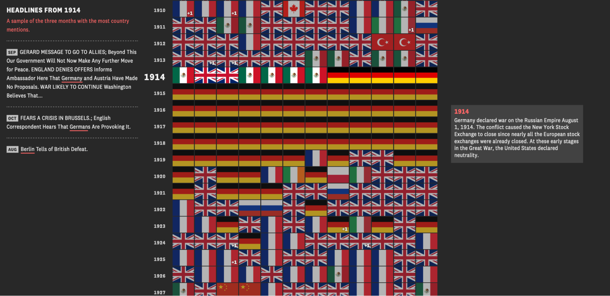
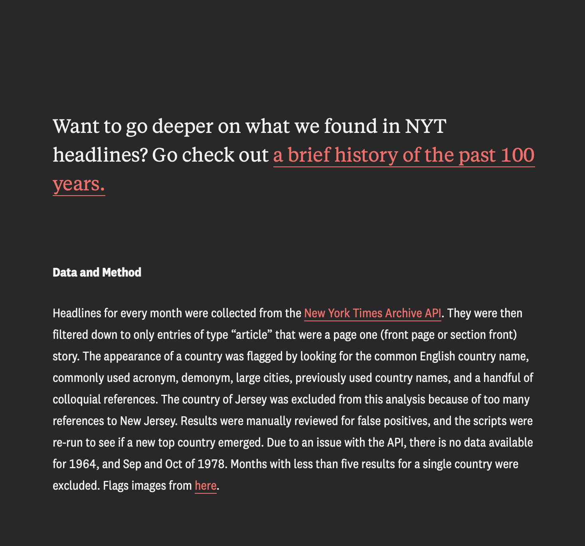
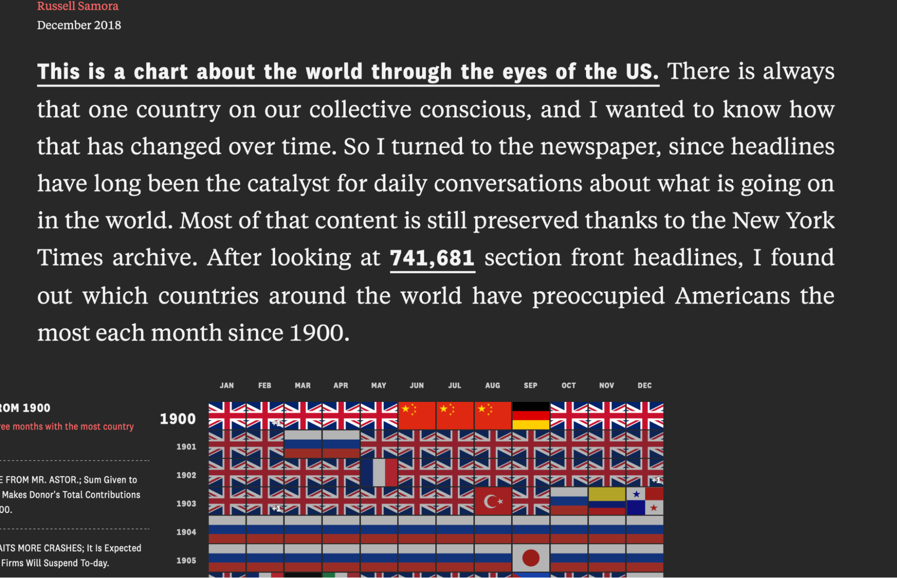

# 	Project Review: *The World through the Eyes of the US*

By: Addie Pentzer

For my data history project I looked at a visualization done by Russell Samora of The  Pudding, called *The World through the Eyes of the US*. The Pudding is not an academic group, but instead falls under a category of visual data journalism that does a lot with pop culture. In his project, Samora examines nearly 741,681 front page stories to piece together which countries prominently preoccupied the minds of Americans each month since 1900. This aligns with the JAH’s categorization of “Essay, Exhibit, Digital Narrative.” The project is organized around a 118 by 12 chart, with each year on the left going down, and all 12 months in that year from left to right.

The motive of this piece is implicit but pretty evident, newspaper headlines can capture a collective consensus in terms of public opinion. Thus, the flag of the country that appears most frequently in each month is assumed to be the one most Americans were thinking about. The grid makes it relatively easy to track the progression of the twentieth century through international conflicts– WWI, to WWII, the Vietnam War, the Cold War, and then the War on Terror. 

While the project is very detailed, this detail is more descriptive than argumentative. Samora shows which countries appeared in headlines, but leaves it at that and hardly elaborates on why the attention shifted. He also never unpacks what this could reveal about American diplomacy abroad or the media and domestic opinion at that moment. Another caveat is that the source of the data is strictly the *New York Times* and it is generalized as all American’s conscience about foreign affairs. This is an issue because the *New York Times* is a paper based in NYC and usually reflects more elite perspectives rather than those of everyday citizens. The argument of this digital project would be strengthened by the inclusion of another paper or an acknowledgement of this gap. 

As previously discussed, the dataset is fully made up of first page stories sourced from the *New York Times* Archive API. Samora used a filter to help flag mentions of countries referenced by name, major cities within them, or acronyms associated with the country. He then manually checked the results looking for potential duplicates or false positives. Samora was quite transparent about this method and its limitations; such as excluding the island of Jersey because there was too much overlap with the state of New Jersey. There are a few months with no country featured either due to a lack of data (1978 NYC newspaper strike) or an inconclusive result for a dominant country. 

There is a limitation to the reporting of these headlines, because all headlines are ‘weighted’ the same, an actual combat war is counted equally to that of a trade war or signing of a treaty. Additionally, because this qualitative data is quantified there is no way to capture tone, only the sheer volume of mentions. The sample headline stories paired to the left of the grid do however do a good job of reminding the viewer that each data point is rooted in a genuine event and real news story. 

The project in its entirety is relatively concise, and not too visually noisy. The project begins with an introduction, jumps straight into the data based visualization, with additional sample headlines that correlate with the given year on the left. Then finishes with a short explanation of methods and a link to a related project on their site. The countries mentioned are depicted using their flag icons making it easy to read and understand. The layout makes it up to the viewer to decide if they would like to dive deeper into a specific year or story instead of  dumping every story included onto the viewer, overwhelming them. 

Since the readability and “choose your own level of information” format are defining characteristics of this website, the project is definitely geared towards a general audience. Samora expects an averagely informed reader, so there is no heavy jargon nor a long length of attention span required. The main message of the project can be easily understood with little time spent on the site, making data more easily accessible to the average viewer. There is a lack of historical scholarship, while the source (NYT) is credible, it is by no means a peer reviewed journal. Although this is not surprising given The Pudding is a “for the people, by the people” driven organization. 

Overall, the visualization was interesting, straightforward, and a creative way to demonstrate a century of media coverage in a digestible format. I really enjoyed diving into this project.

[← Back to portfolio](portfolio.html)